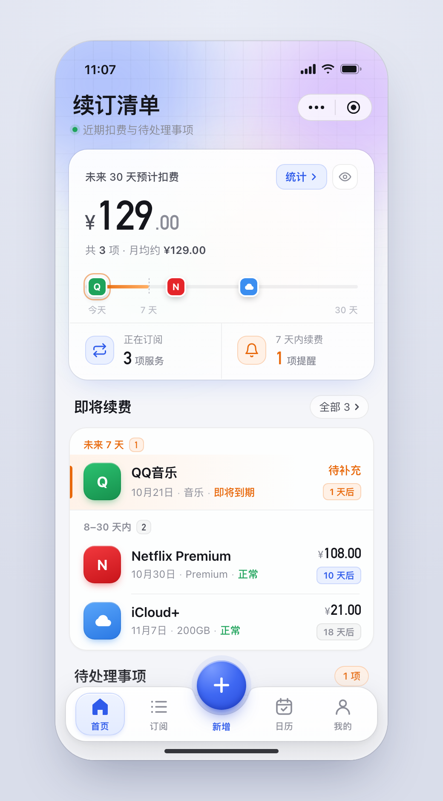

# 续订清单 · UI 设计规范 v1.0

> 适用范围：微信小程序「续订清单」全部主页面与二级页面
> 设计基准：逻辑宽度 **390px**（iPhone 14/15 尺寸），文中所有尺寸单位均为设计 px
> 可运行参考实现：`pages/*.html`（浏览器直接打开即可点击体验动效），样式源码 `assets/tokens.css`、`assets/components.css`、`assets/shell.js`
> 效果图：`renders/`（总览见 `renders/overview.png`）

---

## 0. 本次重构解决什么问题

| 原问题 | 处理方式 |
|---|---|
| 默认组件堆砌感 | 统一材质：浅灰底 + 顶部柔光氛围层 + 1px 细描边白卡片；所有小标签统一为「浅底 + 同色细描边」 |
| 卡片滥用 | 同类信息合并进**一张分组卡**，卡内用 1px 分隔线区分条目；KPI 用卡内分栏，不再拆成多张小卡 |
| 层级不清 | 每页只有一个视觉主角（金额 / 月历 / 会员卡），用字号与字重拉开 3 级层级；状态只用颜色 + 胶囊两种手段表达 |
| 字体排版缺少设计感 | 中文用系统字体，**数字统一 DIN Alternate**，等宽数字；建立固定字号阶梯，不再随意取值 |
| 交互不自然 | 选中态改为滑动底块；所有按压有缩放反馈；切换有统一的时长与缓动曲线 |
| Tab 栏不统一 | 全局只有一套底栏，二级页面不显示底栏（见 §3.1） |

---

## 1. 信息架构

```
底栏（全局唯一）
├── 首页        Tab 0
├── 订阅        Tab 1
├── ＋ 新增     中间凸起按钮 → 新增订阅流程
├── 日历        Tab 2
└── 我的        Tab 3

二级页面（左上返回，不显示底栏）
├── 统计        入口：首页总览卡右上「统计 ›」
└── 会员中心    入口：我的 →「会员权益」条
```

**结构调整说明**：原「统计」Tab 改为二级页面。首页总览卡已经展示「未来 30 天扣费 / 月均」，统计页是它的详情，从总览卡进入更符合使用路径；同时为凸起的「新增」按钮腾出位置。如果产品决定保留「统计」Tab，见 §9 方案 B。

---

## 2. 设计令牌（Design Tokens）

源文件：`assets/tokens.css`，开发时以 CSS 变量形式整体引入 `app.wxss`。

### 2.1 颜色

| 令牌 | 值 | 用途 |
|---|---|---|
| `--bg` | `#F4F5F9` | 页面底色 |
| `--surface` | `#FFFFFF` | 实心表面 |
| `--surface-glass` | `rgba(255,255,255,.86)` | 卡片表面 |
| `--surface-sunken` | `rgba(21,22,28,.035)` | 凹陷底（分段控件、计数徽标） |
| `--ink` | `#15161C` | 标题、主文本、金额 |
| `--ink-2` | `#4A4C57` | 次级强调文本 |
| `--ink-3` | `#8A8C97` | 说明文本、未选中 Tab |
| `--ink-4` | `#B8BAC3` | 占位符、非本月日期、箭头 |
| `--border` | `rgba(21,22,28,.08)` | 卡片 / 控件描边 |
| `--border-strong` | `rgba(21,22,28,.12)` | 胶囊按钮描边 |
| `--hair` | `rgba(21,22,28,.06)` | 卡内分隔线 |
| `--blue` | `#2F5BEA` | 主色：选中、主按钮、链接 |
| `--blue-soft` / `--blue-line` | `#EAF0FF` / `rgba(47,91,234,.16)` | 主色浅底 / 描边 |
| `--orange` (+soft/line) | `#E8690C` | 紧急：7 天内到期、待补充、提醒数 |
| `--green` (+soft/line) | `#1FA35B` | 正常、已登录、已开启 |
| `--red` | `#E5484D` | 分类「影音娱乐」 |
| `--violet` (+soft/line) | `#5B4BDB` | 会员体系专用 |
| `--gold` (+soft/line) | `#C98A1B` | 会员「永久有效」、成就类图标 |

**颜色使用规则**
1. 一个区块内最多出现 **1 种强调色 + 主色**，避免五颜六色。
2. 彩色只用在三处：状态胶囊、图标底块、数据可视化。正文永远是 ink 系。
3. 「浅底 + 同色描边 + 同色文字」是唯一的标签样式，禁止实心彩色小标签（主按钮除外）。

### 2.2 状态语义映射（全局统一）

| 业务状态 | 胶囊样式 | 倒计时胶囊 | 列表行 |
|---|---|---|---|
| 即将到期（≤7 天） | `pill.orange` | `due.hot` | `srow.urgent`：左侧 3px 橙色竖条 + 橙色渐隐底 |
| 正常 | `pill.green` | 8–14 天 `due.mid`（蓝）；>14 天 `due.far`（灰） | 默认 |
| 金额待补充 | 金额位显示 `amount.todo`（橙色文字），不用胶囊 | 同上 | 同上 |
| 试用中 / 待处理 / 逾期 | 建议：试用中 `pill.violet`、待处理 `pill.orange`、逾期 `pill.red`（样式已在 components.css 中提供） | — | 逾期可复用 `urgent` 样式换红色 |

### 2.3 字体

```css
--font:     -apple-system, BlinkMacSystemFont, 'PingFang SC', 'Helvetica Neue', sans-serif;
--font-num: 'DIN Alternate', 'DIN Pro', 'Bahnschrift', -apple-system, sans-serif;  /* 所有金额、日期数字、计数 */
```
数字一律加 `font-variant-numeric: tabular-nums`，保证列表金额右对齐时数字等宽。

**字号阶梯**（只允许使用以下取值）

| 级别 | 字号 / 字重 | 用途 |
|---|---|---|
| Display | 48 / DIN Bold，字距 -0.02em | 页面主金额（整数部分） |
| Display-sub | 24 / DIN Bold，`ink-2`/`ink-3` | 主金额的 ¥ 符号与小数部分 |
| Price-L | 36 / DIN Bold | 会员价格 |
| H1 | 26 / 700 | 一级页面标题 |
| H2 | 17 / 700 | 区块标题（sec-title） |
| H3 | 16 / 700 | 卡片标题（card-title） |
| Nav | 17 / 600 | 二级页导航栏标题 |
| Body-L | 15.5 / 600 | 列表主标题（服务名） |
| Body | 15 / 600 | 设置项标题 |
| Amount | 17 / DIN Bold | 列表金额 |
| Caption | 12.5–13 / 400–500 | 副标题、说明 |
| Meta | 12 / 400 `ink-3` | 列表元信息 |
| Micro | 10.5–11.5 / 600 | 胶囊、Tab 文字、分组标签 |

金额拆分写法：`¥`（24）+ 整数（48）+ `.00`（24，`ink-3`），让整数成为视觉重心。

### 2.4 间距、圆角、阴影

- **间距**：4 的倍数为主（4 / 8 / 12 / 16 / 20 / 24）。页面左右边距：卡片 **16**，标题与区块标题 **20–22**（文字比卡片内缩，形成对齐层次）。卡片之间 **12–14**，区块标题上方 **18–22**。
- **圆角**：`--r-xs 6`（胶囊）· `--r-sm 10`（小按钮）· `--r-md 14`（输入框、按钮）· `--r-lg 20`（卡片）· `22`（主角卡）· `--r-xl 24`（底栏、会员卡）· 图标底块 11–13 · 服务 Logo 13。
- **阴影**（只有 4 种）：
  - `--shadow-1`：普通卡片，几乎不可见，只为分离底色
  - `--shadow-hero`：主角卡，带一点主色的柔光
  - `--shadow-dock`：底栏
  - `--shadow-primary`：主按钮 / 选中 Chip

---

## 3. 组件规范

> 类名与 `assets/components.css` 一一对应，迁移到小程序时建议直接做成同名自定义组件或公共 class。

### 3.1 底栏 Dock（全局唯一）



| 属性 | 值 |
|---|---|
| 位置 | 左右 12，底部 22（+ `env(safe-area-inset-bottom)`），宽 366，高 64 |
| 形状 | 圆角 24，中间顶部有平滑凹槽（SVG 路径见 `shell.js` 中 `NOTCH`），凹槽深 33 |
| 材质 | 白色 95%→75% 纵向渐变；1px `rgba(21,22,28,.09)` 描边；`drop-shadow(0 10px 16px rgba(21,22,28,.13))` |
| 布局 | `grid-template-columns: 1fr 1fr 78px 1fr 1fr`，左右内边距 6 |
| Tab | 图标 24 + 间距 4 + 文字 10.5；未选中 `ink-3` 线框图标；选中 `blue` 600 + 实心图标 |
| 选中底块 | 58×50，圆角 17，`#EEF3FF→#E3EBFF` 渐变 + 1px `blue-line` 描边，内顶高光 |
| 新增按钮 | 直径 58，圆心高出底栏顶边 2px；径向渐变 `#7A9BFF→#3F68F2→#2546D6`；蓝色投影 + 顶部高光 + 底部内阴影；下方「新增」文字常驻 `blue` 600 |
| 底部渐隐 | 底栏后方 110px 高的页面底色渐隐层，内容滚到底栏下时自然淡出 |

**交互**
- 切换 Tab：底块从旧位置滑到新位置，480ms，`cubic-bezier(.25,.8,.25,1)`；行程中途横向拉伸（最多 1.45 倍）再收回。
- 跨过中间按钮时，底块中途压扁到 72% 高、透明度降到 25%，不遮挡「新增」字样。
- 新选中图标：线框淡出，实心图标从 0.7 放大弹入（360ms，`ease-spring`）；整体 0.8→1.12→1 回弹（460ms）。
- 新增按钮：按下 1→0.86→1.06→1（520ms），「+」旋转 90°，白色水波扩散；空闲时每 2.8s 一次很淡的光晕外扩。
- 二级页面（统计、会员中心）**不显示底栏**。

### 3.2 页面头部

- **一级页**（`page-head`）：左侧 H1 标题 + Caption 副标题，右侧留出微信胶囊位（87×32）。标题区上边距 10，左 20。
- **二级页**（`navbar`）：三栏网格 `88px 1fr 88px`，左侧 36×36 返回按钮（圆角 12，白 75% + 描边），中间 17/600 标题居中，右侧胶囊。
- 胶囊位置开发时以 `wx.getMenuButtonBoundingClientRect()` 为准，标题行垂直居中对齐胶囊。

### 3.3 卡片

| 类型 | 规格 |
|---|---|
| `card` | 左右外边距 16，圆角 20，`surface-glass` + 1px `border` + `shadow-1` |
| `card.hero` | 主角卡：圆角 22，白色渐变，外描边 + 主色柔光阴影。**每页最多 1 张** |
| `card.list` | 分组列表卡：`overflow:hidden`，内含 `srow` / `setrow` |
| `card-head` | 卡内标题行：内边距 16 16 0；左 H3 标题 + 可选 Caption，右侧放 `pill.gray` 说明（如「月均」「币种：CNY」） |

### 3.4 列表行

**订阅行 `srow`**
```
[Logo 44] [服务名 15.5/600 + 状态胶囊]          [金额 17 DIN]   [›]
          [周期 · 支付方式 12 ink-3]            [倒计时胶囊]
          [📅 日期 11.5 ink-4]（订阅页才有）
```
- 内边距 13 / 14 / 13 / 16；行间分隔线从 Logo 右侧开始（left 72）。
- 金额缺失时显示「金额待补充」（订阅页）或「待补充」（首页），橙色 13/600。
- 按下：背景 `rgba(21,22,28,.03)`，160ms。

**服务 Logo**：44×44，圆角 13，品牌色 160° 渐变 + 顶部高光 + 同色投影。新增服务时按品牌主色生成同样的渐变，没有品牌色就用 `--blue`。

**设置行 `setrow`**
```
[图标底块 36] [标题 15/600]                    [值 13.5 ink-3] [›]
              [说明 12 ink-3]
```
- 图标底块配色按功能：通知 `blue`、暂停 `gray`、记录 `violet`、规则 `orange`、币种 `green`、订单 `violet`。
- 只有一个值时（如默认币种 CNY），值放在右侧，不放在说明行。

### 3.5 标签类

| 组件 | 规格 |
|---|---|
| `pill` | 10.5/600，内边距 2×7，圆角 6，1px 描边；变体 orange / blue / green / gray / violet / gold |
| `pill.round` | 全圆角胶囊，11.5 号字，用于区块标题右侧计数（如「1 项」）和登录状态 |
| `due` | 倒计时胶囊，规则见 §2.2 |
| `link-pill` | 「全部 3 ›」类跳转：12.5，白 70% 底 + 描边，全圆角 |
| 计数徽标 | 17×17，圆角 6，DIN 11，用于分组标签后（未来 7 天 `1`） |

### 3.6 输入与选择

| 组件 | 规格与交互 |
|---|---|
| 搜索框 `search` | 高 44，圆角 14，白 86% + 描边；聚焦时描边变 `blue-line` + 4px 主色淡光圈 |
| 分类 Chip | 高 34，全圆角，13 号；选中 = 主按钮同款蓝色渐变 + 白字，计数徽标变白 22% 底；按下缩到 0.96 |
| 下划线 Tabs `utabs` | 高 40，项间距 22，14 号；选中 `ink` 600；3px 蓝色圆角下划线跟随滑动（480ms）并自动匹配文字宽度；右侧 18% 渐隐提示可横向滚动 |
| 分段控件 `segmented` | 凹陷底 + 3px 内边距；白色滑块带描边与轻投影，480ms 滑动；选中文字 `ink` 600 |
| 按钮 | 高 44，圆角 14，14/600。`btn-primary` 蓝渐变（每屏最多 1 个）；`btn-soft` 浅蓝底；`btn-ghost` 白底描边。按下 0.97 + 亮度 97% |

### 3.7 数据可视化

- **时间轴（首页）**：30 天轨道，宽度等分；7 天处虚线刻度，0–7 天段橙色渐变填充；每个订阅一个 24×24 的品牌色圆角方块定位在对应天数；最紧急的一项外加橙色描边环。
- **环形图（统计）**：直径 124，线宽 14，圆头端点，段间留 2–3px 间隙；中心两行文字（15/700 + 10.5 `ink-3`）。右侧图例 = 色块 + 名称 + 百分比（DIN）/ 金额（DIN 16）/ 4px 占比进度条。
- **柱状图（统计）**：6 列等宽，间距 10，柱高按数值比例，顶部圆角 9；数值标签在柱顶（DIN 11.5）；底部 1px 基线。月份标签沿用现有实现，放在基线下方，11 号 `ink-3`。
- 分类配色固定：影音娱乐 `--cat-video`，云存储 `--cat-cloud`，音乐 `--cat-music`。新增分类按顺序从 `blue → violet → orange → gold` 取色。

### 3.8 日历

- 月份标题：`2026年10月`，数字 DIN 22，汉字 20/700。
- 右侧：‹ › 合并成一个按钮组（高 32，圆角 11，中间 1px 分隔）+「今天」`btn-soft` 小按钮。
- 星期行 11.5，周末 `ink-4`。
- 日期格：高 50，圆角 13；数字 DIN 16；**今天** = 蓝色渐变方圆底白字；**选中** = `blue-soft` 底 + `blue-line` 描边；非本月 `ink-4`，标记透明度 55%。
- 续费标记：数字下方 6×6 圆角方点，颜色 = 服务品牌色，一天多项时并排（最多 3 个，超出显示 `+n`）；有金额时下方显示合计（DIN 9.5）。
- 当日明细卡：标题「10月30日」+ 星期胶囊，右侧「1 项 · ¥108.00」；空状态 = 虚线框日历图标 + 「当天没有续费项目」+ `btn-soft`「添加到这一天」。

### 3.9 会员视觉（仅会员相关场景使用）

- 会员卡：圆角 24，`#4B3FC9 → #4A55E0 → #3D6CF0` 斜向渐变，右上角径向高光，左上淡网格；问候语用暖金 `#FFD88A`；徽章是旋转 -10° 的玻璃方块 + 金色皇冠 + 星光点缀。
- 「我的」页会员入口：淡紫→淡蓝渐变底 + `violet-line` 描边 + 紫色图标块，与会员中心呼应。
- 已购买状态按钮：`violet-soft` 底 + 紫字 + 对勾，**不可点击**，不用主按钮样式。

---

## 4. 动效规范

| 令牌 | 值 | 用途 |
|---|---|---|
| `--dur-1` | 160ms | 按压反馈、背景色变化 |
| `--dur-2` | 260ms | 颜色 / 透明度变化、内容切换淡入 |
| `--dur-3` | 480ms | 位移类：底栏底块、下划线、分段滑块 |
| `--ease-out` | `cubic-bezier(.25,.8,.25,1)` | 默认缓动 |
| `--ease-spring` | `cubic-bezier(.3,1.4,.5,1)` | 带回弹：图标弹入、按钮回弹 |

**清单**
1. 所有可点元素按下都有反馈：卡片行变底色，按钮 / Chip 缩放 0.94–0.97。
2. 位移类动画只用 `transform`，不动 `left/width`（下划线宽度变化除外）。
3. 列表筛选后的条目依次淡入上移 6px，每条延迟 30ms。
4. 日历切换日期：明细卡内容 260ms 淡入上移。
5. 系统开启「减少动态效果」时关闭所有位移与循环动画，只保留颜色变化。

---

## 5. 页面规范

### 5.1 首页（Tab 0）· `renders/home.png`

| 区块 | 字段 | 组件 |
|---|---|---|
| 头部 | 续订清单 / 近期扣费与待处理事项 | page-head（副标题前绿色在线点） |
| 总览卡 | 未来 30 天预计扣费、¥129.00、共 3 项 · 月均约 ¥129.00 | card.hero + 主金额 |
| 总览卡右上 | **统计 ›**（进入统计页）、隐藏金额 👁 | 浅蓝小按钮 + icon-btn |
| 时间轴 | 由各订阅的到期天数生成 | §3.7 |
| KPI | 正在订阅 3 项服务 / 7 天内续费 1 项提醒（橙） | 卡内两栏 |
| 即将续费 | 全部 3 ›；分组「未来 7 天 1」「8–30 天内 2」；订阅行 | card.list + srow |
| 待处理事项 | 1 项 + 列表 | 内容沿用现有实现，套用 card.list + setrow 样式 |

### 5.2 订阅（Tab 1）· `renders/subscriptions.png`

| 区块 | 字段 | 组件 / 交互 |
|---|---|---|
| 头部 | 全部订阅 / 集中管理每一项持续支出 | page-head |
| 工具行 | 搜索订阅、新增订阅 | search + `btn-soft`（底栏已有主入口，这里降为次级） |
| 分类 | 全部 3 / 云存储 1 / 影音娱乐 1 / 音乐 1 | Chip，可横滑；点击即筛选列表 |
| 状态 | 全部状态 / 有效订阅 / 试用中 / 即将到期 / 待处理 / 逾期… | utabs 下划线滑动 |
| 排序栏 | 按扣费日排序 · 有效订阅 · 3 项 › | 左侧排序按钮（点击弹出排序选项），右侧数量随筛选更新 |
| 列表 | 服务名 + 状态胶囊、周期 · 支付方式、完整日期、金额 / 金额待补充、倒计时 | srow（含第三行日期） |

### 5.3 日历（Tab 2）· `renders/calendar.png`、`renders/calendar-selected.png`

| 区块 | 字段 | 交互 |
|---|---|---|
| 头部 | 续费日历 / 按日期安排续费，查看每天的扣费明细 | — |
| 月历卡 | 2026年10月、‹ ›、今天；日期格 + 续费标记 + 金额 | 点日期选中；点非本月日期自动翻月；「今天」回到当月并选中今天 |
| 当日明细 | 日期 + 星期、N 项 · ¥合计；订阅行或空状态 | 空状态按钮「添加到这一天」→ 新增流程，并预填日期 |

### 5.4 统计（二级页）· `renders/stats.png`

| 区块 | 字段 | 交互 |
|---|---|---|
| 导航 | ‹ 统计 | 返回首页 |
| 总览卡 | 月均订阅支出（估算）、CNY ▾、¥129.00、基于 2 项 CNY 有效订阅 · 不自动换汇 | 币种按钮打开币种选择 |
| 口径切换 | 月均 / 年度 / 未来30天 | 分段控件；切换后金额以数字滚动方式更新（数值由现有逻辑计算） |
| 分类构成 | 月均；影音娱乐 ¥108.00 83.7%；云存储 ¥21.00 16.3% | 环形图 + 图例 |
| 未来支出估算 | 按当前月均估算（6个月）、币种：CNY、6 根柱 | 柱状图（月份标签沿用现有实现） |

### 5.5 我的（Tab 3）· `renders/profile.png`

| 区块 | 字段 |
|---|---|
| 头部 | 我的 / 管理提醒、账号额度与数据偏好 |
| 账户卡（hero） | 头像「续」、续订清单用户、已保存 · 3 项订阅、微信已登录；月均支出 ¥129.00 / 提醒状态 微信通知 |
| 会员入口 | 会员权益 · 会员已开启 · 无限新增订阅 › → 会员中心 |
| 提醒设置 | 续费通知、暂停微信通知、通知发送记录、默认提醒规则（含各自说明） |
| 数据与偏好 | 默认币种 CNY，其余条目沿用现有实现，套用 setrow |

### 5.6 会员中心（二级页）· `renders/member.png`、`renders/member-full.png`

| 区块 | 字段 |
|---|---|
| 导航 | ‹ 会员中心 |
| 会员卡 | 续订清单 · 会员俱乐部、权益已生效、很高兴，有你同行、永久会员、不限订阅数量，陪你从容管理每一次续费。、有效期：永久、无需续费 |
| 权益 | 把喜欢的，都安排好 / 永久会员权益；订阅数量，不设上限（∞）；一次开通，永久拥有；换台设备，权益还在 |
| 免费说明 | ✓ 提醒、统计与导出，免费版也能用 |
| 方案卡 | 你的会员方案、永久有效、永久会员、一次性购买 · 无自动续费、¥9.90、已开通 · 好好享受订阅自由、权益已绑定当前微信账号，无需重复购买。 |
| 订单 | 我的订单 / 查看购买记录与支付状态 › |

未购买状态（设计稿未出图）：方案卡按钮改为 `btn-primary`「¥9.90 开通永久会员」，会员卡换成灰蓝渐变 + 「未开通」胶囊，其余结构不变。

### 5.7 通用状态

- **加载**：卡片保留外框，内部用 `surface-sunken` 圆角骨架块，骨架整体做 1.2s 的透明度呼吸。
- **空列表**：参照日历空状态 —— 虚线图标块 + 一句说明 + `btn-soft` 操作。
- **错误**：卡片内居中显示说明 + `btn-ghost`「重试」，不要用全屏弹窗。

---

## 6. 小程序落地说明

1. **单位换算**：本规范以 390 宽为基准。用 rpx 时换算为 `rpx = px × 750 / 390 ≈ px × 1.923`；1px 描边、分隔线保持 `1px` 不换算，以免在低分屏消失。
2. **自定义 TabBar**：`app.json` 中 `tabBar.custom: true`，实现 `custom-tab-bar` 组件。`list` 只配置首页、订阅、日历、我的 4 项；中间新增按钮是组件内的普通按钮，点击 `wx.navigateTo` 进入新增页。
3. **跨页滑动动画**：每个 Tab 页都有独立的 `custom-tab-bar` 实例。做法是把上一个选中序号存进全局变量；新页面 `onShow` 时先把底块放在旧位置（关闭 transition），下一帧再设为新位置（开启 transition），这样切页时也能看到滑动。
4. **动画实现**：小程序没有 Web Animations API。位移用 `transition: transform 480ms cubic-bezier(.25,.8,.25,1)`；拉伸回弹用 `@keyframes` 加 class 触发，`animationend` 后移除 class。
5. **凹槽形状**：优先用 SVG 背景图（`background-image: url(data:image/svg+xml...)`）画底栏形状与描边，不依赖 `clip-path: path()`，兼容性更稳。
6. **毛玻璃**：底栏不使用 `backdrop-filter`（Android 端性能差），用 95%→75% 白色渐变替代，视觉差异很小。
7. **字体**：DIN Alternate 在 iOS 自带；Android 回退到系统字体。如需两端一致，可用 `wx.loadFontFace` 加载 DIN 子集（只含 `0-9 ¥ . , % -`，体积约 10KB）。
8. **安全区**：底栏 `bottom: calc(22px + env(safe-area-inset-bottom))`；页面底部留白 = 底栏高度 + 56。
9. **热区**：所有可点元素热区 ≥ 44×44，小按钮（如 30×30 的眼睛图标）用透明 padding 扩大热区。

---

## 7. 可访问性

- 正文对比度：`ink` / `ink-2` 在白底上均 > 7:1；`ink-3` ≈ 3.5:1，只用于辅助说明，不承载关键信息。
- 状态不只靠颜色：即将到期同时有文字胶囊和左侧竖条；倒计时用文字「1 天后」。
- 底栏 Tab 加 `aria-role="tab"` 与 `aria-selected`；新增按钮 `aria-label="新增订阅"`；隐藏金额按钮 `aria-label="隐藏金额"`。

---

## 8. 开发检查清单

- [ ] 页面中所有颜色、圆角、阴影都来自令牌，不出现新的十六进制值
- [ ] 所有金额、日期数字、计数使用 `--font-num` + `tabular-nums`
- [ ] 每屏最多 1 个 `btn-primary`、1 张 `card.hero`
- [ ] 标签全部为「浅底 + 同色描边」样式
- [ ] 一级页显示统一底栏，二级页不显示
- [ ] 所有可点元素有按压反馈；位移动画 480ms、颜色动画 260ms
- [ ] 开启「减少动态效果」后无位移动画
- [ ] 内容滚动到底栏下方时有渐隐，不被硬切

---

## 9. 待确认事项

| # | 问题 | 当前设计 | 备选 |
|---|---|---|---|
| 1 | 底栏结构 | **方案 A（已出图）**：首页 / 订阅 / ＋新增 / 日历 / 我的；统计从首页进入 | **方案 B**：首页 / 订阅 / 日历 / 统计 / 我的，不要凸起按钮。Dock 改为 5 等分、去掉凹槽，选中底块与动效不变；新增入口回到订阅页工具行（恢复为 `btn-primary`） |
| 2 | 状态 Tab 最后一项完整文案 | 截图中被截断，暂写「逾期」 | 以代码中的实际文案为准 |
| 3 | 未来支出估算的月份标签 | 设计稿未画（原截图不可见） | 沿用现有实现，样式见 §3.7 |
| 4 | 我的 →「数据与偏好」除默认币种外的条目 | 原截图不可见 | 沿用现有条目，套用 setrow |
| 5 | 首页「待处理事项」的条目内容 | 原截图不可见 | 沿用现有实现，套用 card.list |

---

## 10. 文件清单

```
ui-redesign/
├── UI-设计规范.md            本文档
├── assets/
│   ├── tokens.css            设计令牌
│   ├── components.css        组件样式
│   └── shell.js              状态栏 / 胶囊 / 底栏 / 滑块控件
├── pages/                    可交互参考页面（浏览器打开即可点击）
│   ├── home.html  subscriptions.html  calendar.html
│   ├── stats.html  profile.html  member.html
├── renders/                  效果图（2x）
│   ├── overview.png          全部页面总览
│   ├── home.png  subscriptions.png  calendar.png  calendar-selected.png
│   ├── stats.png  profile.png  member.png  member-full.png
└── render.sh                 重新出图脚本：./render.sh <page> [full]（依赖本机 Chrome；full 长图模式的自动裁切需要 Python Pillow）
```
